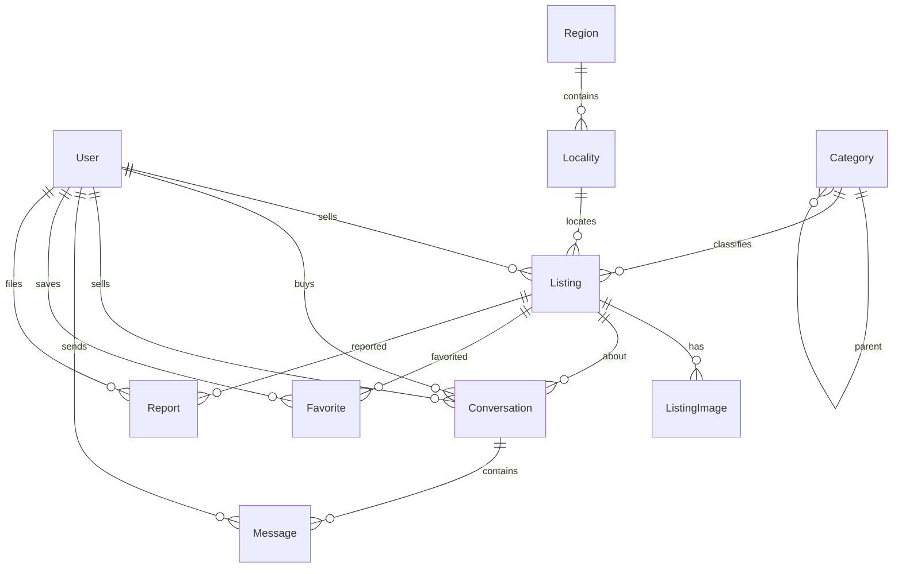

# Доменная модель Ad App

**Обновлено**: 03.11.2026  
**Статус**: канон для типов, Prisma и use-case слоёв ([ADR 0003](../adr/0003-domain-model.md))

## Опора на аналоги

| Источник | Что взяли | Что сознательно не взяли в MVP |
| --- | --- | --- |
| **Kufar.by** (импорт/фильтры) | `region` + `area` (область/Минск + город/район); дерево категорий; `condition`, `price`, `currency`, фото | Бизнес-аккаунты, аренда/услуги как отдельные продукты, USD по умолчанию |
| **OLX-класс** | `listings` ↔ owner/category/geo/price/status; чат = thread на listing | Платежный escrow |
| **Marketplace DB patterns** | один User (buyer+seller); JSONB `attributes`; Conversation unique(listing, buyer); favorites; price в минорных единицах | Stripe/transactions, reviews, featured ads |
| **Sharetribe** | гибкие атрибуты объявления без жёсткой схемы колонок | Полный EAV-конструктор категорий в v1 |
| **OpenAdClassify / sample classifieds** | Category tree, media отдельно, messaging, flags | Отдельный Nest+Redis обязательным |

Принцип: **сначала инварианты домена**, потом таблицы. Prisma — адаптер; доменные правила не живут только в ORM.

## Слои (Clean Architecture × FSD)

```text
Domain (entities + value objects + enums + инварианты)
    ↑ use-cases / application services (features/*)
    ↑ adapters: Prisma, Better Auth, storage, SMS
    ↑ delivery: app/ routes, RSC, server actions
```

| SOLID | Как применяем |
| --- | --- |
| SRP | `Listing` не знает про SMS; `Conversation` не шлёт email с текстом сделки |
| OCP | новые поля категории → `attributes` JSONB, без ломки колонок Listing |
| LSP/ISP | публичный DTO listing **без** phone; contact DTO только для authenticated |
| DIP | use-case зависит от портов (`ListingRepository`), Prisma — реализация |

## Карта сущностей

### MVP — реализуем в первой схеме

| Сущность | Роль | FSD |
| --- | --- | --- |
| `User` | частное лицо; профиль; статус аккаунта | `entities/user` |
| `Account` / `Session` / `Verification` | провайдеры Better Auth (инфраструктура identity) | `shared` / auth adapter |
| `Category` | дерево категорий объявлений | `entities/category` |
| `Region` | 6 областей + г. Минск | `entities/location` |
| `Locality` | город / район (как Kufar `area`) | `entities/location` |
| `Listing` | объявление | `entities/listing` |
| `ListingImage` | фото, порядок, storage key | `entities/listing` |
| `Conversation` | тред buyer↔seller по одному listing | `entities/conversation` |
| `Message` | сообщение in-app | `entities/conversation` |
| `Favorite` | избранное | `entities/favorite` |
| `Report` | жалоба на listing/user (trust & safety минимум) | `entities/report` |

### Фаза 2 — заложить в голове, не в MVP-миграции

| Сущность | Зачем позже |
| --- | --- |
| `Notification` | badge «новое сообщение» без тела в канале |
| `Review` / рейтинг | после явной сделки/закрытия |
| `CategoryAttribute` + values | жёсткие фильтры по марке/году вместо только JSONB |
| `ListingStatusHistory` | аудит модерации |
| `UserBlock` | блок собеседника |
| `AuditLog` | админ-действия |
| `Promotion` / featured | платное продвижение |
| `Payment` / `Transaction` | если появятся услуги платформы |

### Не делаем (анти-модель)

- Отдельные таблицы `Buyer` / `Seller`
- Мультистрана / адресный геокодер в v1
- Хранение **только** URL картинок в JSON без сущности медиа (ломает удаление из storage)
- Вынос текста переписки в email/TG
- Компании / salon-аккаунты
- Плавающая цена `float` — только целые **копейки** (`priceMinor`) + `BYN`

## ER (логика)



## Поля и инварианты (MVP)

### User

| Поле | Тип | Заметки |
| --- | --- | --- |
| `id` | uuid | PK |
| `email` | string? | unique если задан; из Better Auth |
| `emailVerifiedAt` | datetime? | |
| `phoneE164` | string? | `+375…`; unique если верифицирован |
| `phoneVerifiedAt` | datetime? | показ телефона на карточке только если set |
| `displayName` | string | |
| `avatarKey` | string? | storage |
| `role` | enum | `USER` \| `ADMIN` |
| `status` | enum | `ACTIVE` \| `SUSPENDED` \| `BANNED` |
| `createdAt` / `updatedAt` | datetime | |

Инвариант: гостю не отдаём `phoneE164`. Авторизованному — только если `phoneVerifiedAt != null` у автора listing.

### Category

| Поле | Тип | Заметки |
| --- | --- | --- |
| `id` | uuid | |
| `parentId` | uuid? | self-FK |
| `name` | string | |
| `slug` | string | unique |
| `sortOrder` | int | |
| `isActive` | bool | |
| `allowsListing` | bool | публиковать обычно в «листе» дерева |

### Region / Locality

| Region | Locality |
| --- | --- |
| `code` (1–7 как у Kufar-ориентир), `name`, `slug` | `regionId`, `name`, `slug`, `sortOrder`, `isActive` |

Страна фиксирована **BY** в конфиге приложения, не колонкой на каждой строке.

### Listing

| Поле | Тип | Заметки |
| --- | --- | --- |
| `id` | uuid | |
| `sellerId` | uuid | FK User |
| `categoryId` | uuid | предпочтительно leaf |
| `localityId` | uuid | FK Locality |
| `title` | string | 3–120 |
| `slug` | string | unique; для URL |
| `description` | text | |
| `priceMinor` | int? | копейки BYN; null = «договорная» |
| `currency` | char(3) | всегда `BYN` в MVP |
| `condition` | enum | `NEW` \| `USED` \| `FOR_PARTS` \| `NOT_APPLICABLE` |
| `attributes` | jsonb | категория-специфика (`brand`, …) |
| `status` | enum | см. FSM |
| `publishedAt` | datetime? | |
| `soldAt` | datetime? | |
| `deletedAt` | datetime? | soft delete |
| `viewCount` | int | денорм. |
| `createdAt` / `updatedAt` | datetime | |

**FSM статуса:**

```text
DRAFT ──► PUBLISHED ──► RESERVED ──► SOLD
              │             │
              ├─────────────┴──► ARCHIVED
              └──► HIDDEN (модерация / владелец)
```

Переходы только через use-case (`publishListing`, `markSold`, …), не «сырой» update status из UI.

Индексы (ориентир): `(status, publishedAt DESC)`, `categoryId`, `localityId`, `sellerId`, GIN по `attributes` при появлении фильтров.

### ListingImage

| Поле | Тип |
| --- | --- |
| `id`, `listingId`, `storageKey`, `sortOrder`, `width?`, `height?`, `createdAt` | |

Инвариант: max N фото на listing (конфиг, напр. 10); одно «первое» = `sortOrder = 0`.

### Conversation / Message

| Conversation | Message |
| --- | --- |
| `listingId`, `buyerId`, `sellerId` (денорм. с listing.sellerId для запросов inbox) | `conversationId`, `senderId`, `body`, `createdAt`, `readAt?` |
| `status`: ACTIVE \| ARCHIVED \| BLOCKED | без вложений в MVP (или JSON later) |
| `lastMessageAt` | |
| **UNIQUE** `(listingId, buyerId)` | |

Инварианты:

- `buyerId != sellerId`
- `sellerId` должен совпадать с `listing.sellerId` на create
- участник только buyer или seller; иначе 403
- текст никуда не реплицируется во внешние каналы (ADR 0002)

### Favorite

`UNIQUE (userId, listingId)`.

### Report

| Поле | Тип |
| --- | --- |
| `reporterId`, `listingId?`, `reportedUserId?`, `reason` enum, `comment?`, `status` (OPEN/REVIEWED/DISMISSED), `createdAt` | |

Хотя бы одна цель: listing или user.

## Публичные vs чувствительные данные

| Данные | Guest | Auth user | Owner / Admin |
| --- | --- | --- | --- |
| Карточка listing | да | да | да |
| Телефон продавца | нет | да (если verified) | да |
| Inbox / messages | нет | свои треды | свои + admin |
| email продавца | нет | нет | admin / self |

Маппинг в коде: отдельные DTO (`ListingPublic`, `ListingContact`, `ListingOwner`) — не один Prisma-include «на всё».

## Связь с Prisma / типами

1. Enums и entity-типы — в `entities/*/model` (домен).
2. Zod-схемы на границах input (create/update/search).
3. Prisma models 1:1 с таблицами выше (+ таблицы Better Auth).
4. Use-case оркестрирует инварианты FSM и ACL переписки.

Черновик Prisma появится при scaffold; **этот документ** остаётся источником правды при расхождении.
