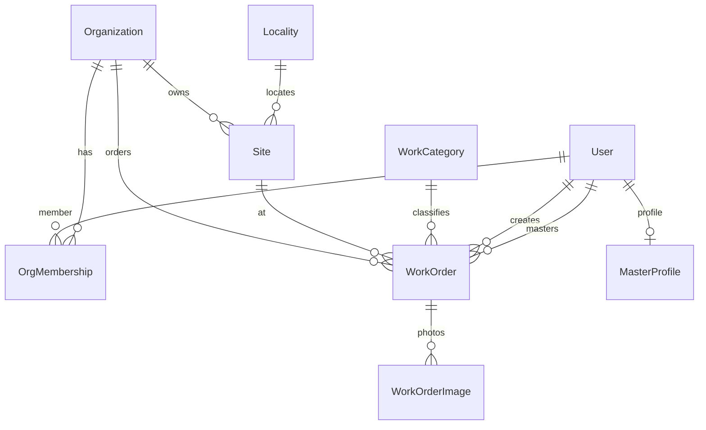

# Доменная модель Завхоз

**Обновлено:** 04.11.2026  
**Статус:** канон ([ADR 0005](../adr/0005-zavhoz-domain-model.md))  
**Бизнес:** [business-model-zavhoz-ru.md](business-model-zavhoz-ru.md)

## Опора

| Источник | Берём | Не в MVP |
| --- | --- | --- |
| Бриф Завхоз | заявка→мастер→фото после→акт/оплата | ЭДО, эквайринг, радиус-пуш |
| Field-service / Jobber-класс | Job/WorkOrder, Site, tech assign | Полный inventory/склад |
| Наш стек объявлений | User, Region/Locality, upload, FSM/DTO | Listing, Favorite, C2C chat |

Принцип: **инварианты домена → Prisma**. Цена только `priceMinor` + `BYN`.

## Слои

```text
entities/*/model     DTO, FSM, мапперы
features/*/model     use-cases
shared               prisma, auth, storage
app/                 routes, тонкие server actions
```

## MVP-сущности

| Сущность | Роль |
| --- | --- |
| `User` | identity (Better Auth); не плодим Buyer/Seller |
| `Organization` | юрлицо / ИП клиента (кофейня-сеть и т.п.) |
| `OrgMembership` | User↔Org + role: OWNER \| MANAGER \| VIEWER |
| `Site` | объект/точка (адрес, `localityId`, `organizationId`) |
| `WorkCategory` | дерево услуг; у листьев `basePriceMinor?` (MVP-прайс до PriceListItem) |
| `MasterProfile` | User-мастер: навыки, `localityId`, active |
| `WorkOrder` | заявка на работу |
| `WorkOrderImage` | фото BEFORE/AFTER + sortOrder + storageKey |
| `Region` / `Locality` | гео РБ (reuse) |

### WorkOrder — поля (логика)

- `organizationId`, `siteId`, `categoryId`
- `createdById` (User)
- `masterId?` (User с MasterProfile)
- `title`, `description`
- `status` (FSM)
- `priceMinor?`, `currency` = BYN (оценка/прайс; null пока не оценено)
- `platformFeeBps?` (напр. 2000 = 20%; опционально из конфига)
- `scheduledAt?`, `closedAt?`
- timestamps + soft `deletedAt?`

### WorkOrderImage

- `workOrderId`, `storageKey`, `sortOrder`, `kind`: `BEFORE` | `AFTER`
- Инвариант: max N фото на kind (конфиг, напр. 8)

## FSM WorkOrder

```text
DRAFT → SUBMITTED → ESTIMATED → OFFERED → ACCEPTED
  → IN_PROGRESS → AWAITING_CONFIRM → CLOSED

Из SUBMITTED|ESTIMATED|OFFERED|ACCEPTED|IN_PROGRESS → CANCELLED
Из AWAITING_CONFIRM → IN_PROGRESS (спор/доработка) или CLOSED
```

Переходы **только** через `canTransitionWorkOrder` / use-case.  
Публичный DTO заявки для мастера **без** лишних реквизитов орг. (ИНН и т.д. — owner/dispatcher).

## Фаза 2 (не в первой миграции)

| Сущность | Зачем |
| --- | --- |
| `PriceListItem` | фикс-прайс по категории/региону |
| `WorkOrderEvent` | аудит статусов |
| `Subscription` / retainer на Site | абонплата сети |
| `Payment` / ledger | списание баланса, комиссия |
| `MaterialLine` | чеки запчастей + наценка |
| `Notification` | push/SMS |
| Электронный акт / ЭДО export | юр. контур |

## Анти-модель

- Float-цены
- Только URL в JSON без `WorkOrderImage`
- Назначение мастера в обход FSM
- Увод сделки в личный Telegram клиента (ops-бот мастеров на старте — вне домена продукта, не вместо статуса заявки)
- Смешение Listing и WorkOrder в одной FSM
- Микросервисы / отдельная очередь «на вырост»

## ER (логика)



## DTO-безопасность

| DTO | Кому | Содержимое |
| --- | --- | --- |
| `WorkOrderPublic` | мастер (назначенный) | сайт (район/адрес кратко), описание, фото, цена |
| `WorkOrderOrg` | член Org | полное + статусы + мастер имя |
| `WorkOrderDispatch` | dispatcher/admin | всё для назначения |

Телефоны мастера/клиента — только авторизованным ролям по ACL, не в публичных списках.
